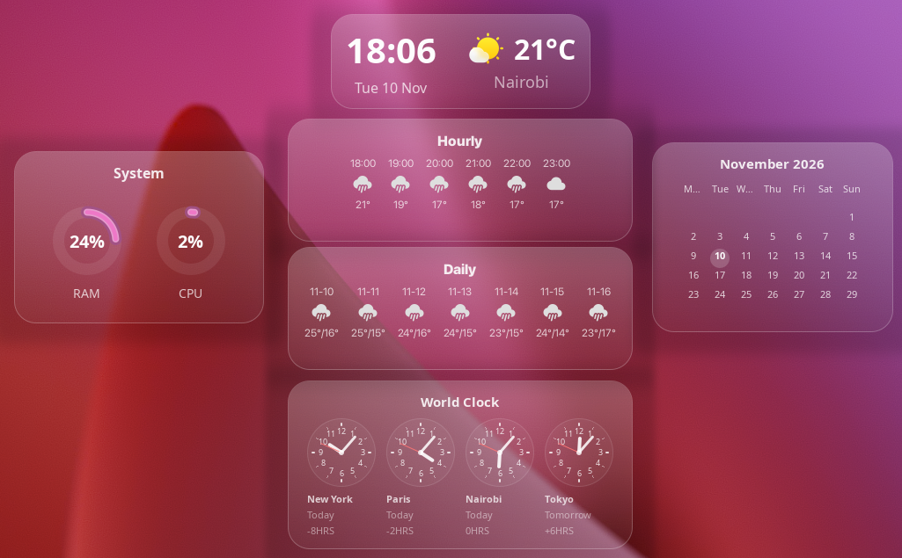
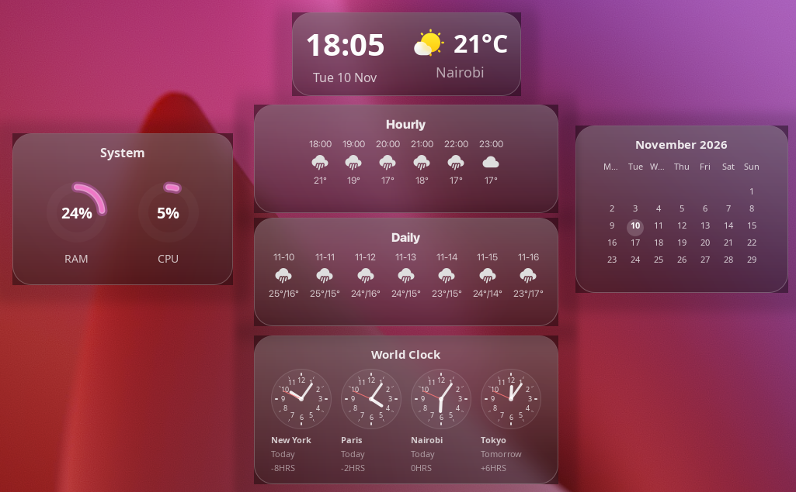

# Glass Widgets


by Peter Njoroge
Frosted glass desktop widgets for GNOME Shell - clock, system stats, and more.

https://extensions.gnome.org/extension/10416/glass-widgets/

[](https://github.com/sponsors/peter-njoro)

### clear

### blured


## Features

- **Clock widget** - live clock with frosted glass styling
- **System stats widget** - RAM and CPU usage with doughnut gauges
- **Weather** - current conditions plus optional hourly and daily forecasts (3-7 days, default 7), automatic or manual location, and Celsius/Fahrenheit units
- **Calendar widget** - current month view with today highlighted
- **World clock** - analog clocks for configurable timezones
- **Clock styling** - optional 12/24-hour format, font weight, size ratio, and color controls
- **Internationalization** - locale resources packaged with the extension; includes Russian and Hungarian translations (coverage depends on strings wrapped for gettext)
- **Media player** - intentionally deferred; this feature will ship in a later release after D-Bus/AppArmor sandboxing issues are resolved
- Independent position controls, opacity, and visibility toggles for widgets
- Glass reflection sheen enabled by default, with optional blur effect
- Tier 1 CSS-only glassmorphism (no shader dependencies)
- Accent color aware - pipeline arcs follow the system accent color (pair it with [Auto Accent Colour](https://extensions.gnome.org/extension/7502/auto-accent-colour/) to sync it automatically with your wallpaper)

## Install

### From extensions.gnome.org

1. Visit [Glass Widgets on extensions.gnome.org](https://extensions.gnome.org/extension/10416/glass-widgets/)
2. Toggle on

### Manual

```bash
git clone https://github.com/peter-njoro/glass-widgets.git
cd glass-widgets
gnome-extensions pack --extra-source=widgets --extra-source=stylesheet.css --extra-source=locale
gnome-extensions install glass-widgets@peter-njoro.github.io.shell-extension.zip
```

`gnome-extensions pack` may produce `glass-widgets@peter-njoro.github.io.shell-extension.zip` (current output name). Install the generated archive if the filename differs.

For EGO/submission packages, avoid shipping translation source files (`*.po`) inside `locale/`. A simple approach is to pack from a clean locale tree that contains only compiled catalogs:

```bash
tmp=$(mktemp -d)
mkdir -p "$tmp/locale"
rsync -a --include='*/' --include='*.mo' --exclude='*' locale/ "$tmp/locale/"
gnome-extensions pack --extra-source=widgets --extra-source=stylesheet.css --extra-source="$tmp/locale"
rm -rf "$tmp"
```

Then log out and back in, or restart GNOME Shell.

## Notes

### Blur

The blur effect uses GNOME Shell's built-in `Shell.BlurEffect`; Blur My Shell is not required. Enable it from Glass Widgets preferences.

### Media player (deferred)

The MPRIS media-player widget is intentionally disabled in the current stable build and will be shipped in a later release. The implementation is being held back because sandboxed players such as Snap-based Spotify can block or destabilize access over the session D-Bus.

### Weather location names

Under **Weather > Location > Location name provider**, choose the local GWeather database (default), OpenStreetMap Nominatim, or Photon. The local database can name a nearby city rather than the town at your coordinates.

Online name resolution works with both automatic and manual locations. It sends your coordinates rounded to four decimal places to the selected service, requires no API key, and does not change the coordinates used for weather forecasts. Successful lookups are cached while the extension is running; failed lookups fall back to the local GWeather name. Rounded coordinates still reveal an approximate location.

Nominatim and Photon use [OpenStreetMap data](https://www.openstreetmap.org/copyright).

The public [Nominatim usage policy](https://operations.osmfoundation.org/policies/nominatim/) limits the entire application's traffic to one request per second and requires caching, application identification, and attribution. Use it only for occasional lookups, not bulk geocoding or continuous tracking; select Photon or the local database if the public service cannot accommodate your use. Requests are debounced by one second and identify Glass Widgets. Neither public service guarantees availability.

### Weather availability

Forecast cards show "Forecast unavailable" when data cannot be retrieved; the clock's weather column shows "Weather unavailable". A smaller "Will retry automatically" line accompanies either message. "Refreshing..." is shown while the initial location is being resolved or a weather request is active.

Weather requests retry on the regular 30-minute update schedule; forecasts also retry when network connectivity returns. If no location is available, the unavailable message remains until a usable location is supplied.

### World clock

Enter IANA timezone IDs rather than city names, for example `Europe/Paris` not `Europe/Istres`. Istres, France uses the same timezone as Paris.

Each clock shows its city, the day relative to your system date, and the signed hour difference from your system timezone below the dial. Hour marks, the second hand, dial numbers, and the relative day/hour text can be toggled independently in preferences.

### Widget positions

Position percentages accept two decimal places. The increment and decrement buttons change the value by 0.5 percentage points; manually entered values are not rounded to that step. Existing saved positions are migrated automatically.

Each widget is positioned independently by its center on the primary monitor. Toggling or resizing one widget does not recreate or reposition the others. Re-enabling a widget restores its own saved position.

## Development

```bash
git clone https://github.com/peter-njoro/glass-widgets.git
ln -s $(pwd) ~/.local/share/gnome-shell/extensions/glass-widgets-dev@peter-njoro-dev.github.io  # Make sure to update metadata.json uuid
```

## License

GPL-3.0 - see [LICENSE](LICENSE).
